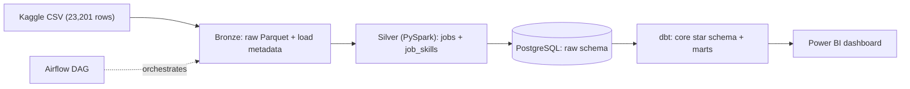

# HireScope: Indian Tech Job Market Pipeline

An end-to-end **batch data engineering pipeline** on a single Naukri snapshot of 23,201 Indian tech job postings: Bronze/Silver Parquet with PySpark, PostgreSQL, a dbt star schema with marts, Airflow orchestration, and a Power BI dashboard.

## Architecture



| Layer | What happens | Output |
|---|---|---|
| Bronze | CSV read as strings, load metadata added (batch id, SHA-256, timestamp), row-count reconciliation | `data/bronze/job_postings` (Parquet) |
| Silver | Dedupe, undisclosed/invalid salaries set to null, city and skill normalisation via alias lists, one row per job and per job-skill | `data/silver/jobs`, `data/silver/job_skills` |
| Load | Parquet loaded into Postgres (truncate and reload, single transaction) | `raw.jobs`, `raw.job_skills`, `raw.load_metadata` |
| dbt | Staging views, star schema, dashboard marts, generated docs | `core.*`, `marts.*` |
| Orchestration | Airflow DAG `hirescope_pipeline`: ingest_bronze, process_silver, load_postgres, dbt_run, dbt_docs | `airflow/dags/hirescope_dag.py` |

**Star schema:** `fact_job_posting`, `dim_role`, `dim_location`, `dim_company`, `dim_skill`, `bridge_job_skill`.
**Marts:** `mart_job`, `mart_job_skill`, `mart_skill_pairs`.

## Data and known limitations

- Source: Kaggle "Indian Tech Job Market 2026 | 23K+ Records" (shree0910), scraped from Naukri on 2025-06-10. It is a **single snapshot: no trend analysis**.
- 23,201 raw rows, 22,649 after dedupe (title + company + cleaned city); 44 clean cities (198 raw spellings); about 10.4K distinct skills (171K job-skill rows).
- Salaries are disclosed for only about 11% of postings (2,591 valid after checks); salary views use these only.
- `company_rating` and `days_since_posted` are median-imputed in the source and are dropped.
- Company size "Mid (100-999)" is very sparse in the source.
- Generic Naukri tags (for example "Analytical", "Data") are flagged `is_generic` and excluded from skill rankings.

## Dashboard

Built in Power BI on the dbt `marts` schema (`dashboard/hirescope.pbix`). Filters: role, city, experience level, work mode.


Pipeline run in Airflow:


## Run it yourself (macOS)

Requirements: Docker Desktop, Java 17, [uv](https://github.com/astral-sh/uv).

```bash
git clone <your-repo-url> hirescope && cd hirescope
cp .env.example .env
# Download the Kaggle CSV and save it as data/raw/indian_tech_jobs.csv
uv venv --python 3.11 .venv && source .venv/bin/activate
uv pip install -r requirements.txt
./run_pipeline.sh
```

Or run it with Airflow (UI at http://localhost:8080, login admin / admin):

```bash
docker compose up -d --build postgres airflow-init airflow-webserver airflow-scheduler
docker compose exec airflow-scheduler airflow dags trigger hirescope_pipeline
```

dbt docs: `cd dbt/hirescope && export DBT_PROFILES_DIR=$PWD && dbt docs serve --port 8081`

## Repository layout
data/{raw,bronze,silver}/ Parquet layers (gitignored)
src/ ingest_bronze.py, process_silver.py, aliases.py, load_postgres.py
dbt/hirescope/ staging, core (star schema), marts
airflow/dags/ hirescope_dag.py
dashboards/ Metabase SQL (first dashboard iteration)
dashboard/ Power BI file
docs/ data dictionary, screenshots
docker/ Postgres init, Airflow image
exit

See [docs/data_dictionary.md](docs/data_dictionary.md) for fields and cleaning rules.

## Stack

Python, PySpark (local mode), Parquet, PostgreSQL, dbt Core, Apache Airflow, Docker Compose, Power BI, Git/GitHub.
